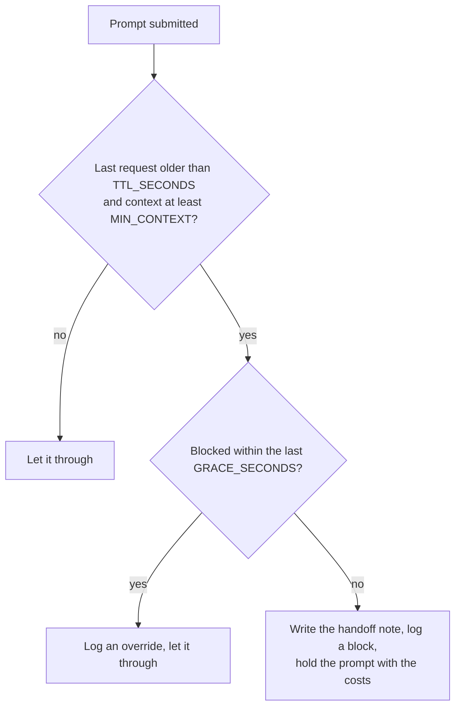
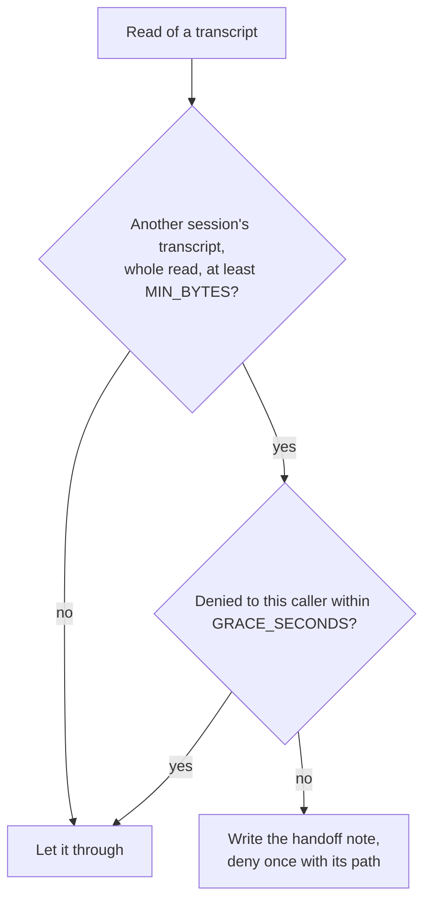

# Why the guards exist

## The cost they avoid

Claude Code keeps a session's context in a prompt cache, and a cached token is read at a tenth
of the input price. The cache lasts a limited time after the last request: this project assumes
one hour. Come back later and the next request writes the entire context again, at twice the
input price. For a session of 200k tokens that is a 400k-token bill for a single "ok, go on",
followed by the cheap 20k per call again. Starting fresh from a short summary often costs less
than that first call, and the model works better with a small context anyway.

Nothing in the session warns you. The prompt looks like any other, so the cost is invisible
until the usage report. That is what the cache guard is for.

The archive guard targets the cousin of this mistake: asking an agent to look at an old session
and watching it read the whole 300 kB transcript into a context that did not need it. A summary
and a search through the transcript carry what the next step needs.

## Why a block once, not a refusal

The cache guard's decision for each prompt:

The archive guard decides the same way for each whole read of a past session:

The guards cannot know what you want, only what it would cost. So they inform and then step
aside: the first prompt is held with the numbers and a way out, and the same action repeated
goes through. A guard that refused would be wrong whenever the long session is the right one.
The grace periods, 10 minutes for the cache guard and 30 for the archive guard, are the time
you have to say "I know".

## Why a handoff note, built without a model

The way out has to be cheap, or the guard only moves the cost. `handoff.py` builds the note
from the transcript with plain parsing: the task as first asked, the latest prompts, the
recaps, the task list, the files touched, the last reply and the transcript path to search.
That reads in a few thousand tokens. It cannot be as good as a summary written by a model, but
it costs no tokens, works offline, cannot hallucinate, and tells the next session where the
detail is when it needs it.

## Why the guards never fail loudly

A hook sits on the path of every prompt or tool call. A guard that crashes, prints a traceback
or answers in the wrong format blocks work it was never meant to touch, and a hook someone has
to disable is a hook that saves nothing. So each guard acts only on the exact event it
understands, and on anything else, including its own failures, it exits 0 with no output.
`REAR_GUARD_DEBUG=1` is the opt-in way to hear why.

## Why a log

A guard's value is the tokens it saves, and those are invisible by nature: a prompt that was
never sent. The log records each block and each override so the saving can be estimated later.
The estimate is an upper bound, since the hook cannot tell a new session from an abandoned one.
It is still better than not knowing. See the [event log reference](../reference/event-log.md).
