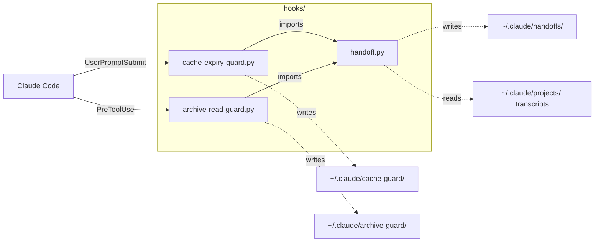

# Hooks reference

Three Python files in `hooks/`. Python 3.9 or later, standard library only, no model call.
Claude Code only.



## Behaviour common to both guards

A guard acts only on the event it was written for. It prints nothing, writes nothing to
stderr and exits 0 when:

- stdin is empty, not JSON, or JSON that is not an object with the expected fields;
- the event comes from another harness or has fields of the wrong type;
- the transcript is missing, unreadable or in another format;
- `handoff.py` is not next to the hook;
- anything raises.

`REAR_GUARD_DEBUG=1` sends the reason to stderr instead. The exit code stays 0.

## `cache-expiry-guard.py`

Event: `UserPromptSubmit`. Reads `session_id` and `transcript_path` from stdin.

**Acts when** the last main-chain request of the transcript ended more than `TTL_SECONDS` ago
and its context held at least `MIN_CONTEXT` tokens. Only the last `TAIL_BYTES` of the
transcript are read to find it. Context tokens are the sum of input, cache-creation and
cache-read tokens of that request.

**Output**, on a block:

```json
{"decision": "block", "reason": "Prompt cache expired 2.0 h ago. This session holds 200k tokens: …"}
```

The reason gives the idle time, the context size, the cost of continuing, the cost of a new
session and the path of a freshly written [handoff note](handoff-note.md).

**Override:** a block writes `~/.claude/cache-guard/<session_id>.blocked`. A prompt arriving
within `GRACE_SECONDS` of it goes through, removes the marker and is logged as an override.

**Cost model**, in input-token equivalents (cache write 2×, cache read 0.1×):

| | First call | Each later call |
|---|---|---|
| Continue the expired session | `2 × tokens` | `tokens ÷ 10` |
| Start a new session | `2 × (baseline − cached) + cached ÷ 10` | `baseline ÷ 10` |

`baseline` is the context of the transcript's first request. `cached` is that request's cache
read, counted only if another transcript under the same projects directory was modified within
`TTL_SECONDS`, since that session keeps the shared prefix warm. When no first request is found,
`baseline` is `FALLBACK_BASELINE`.

| Constant | Default | Meaning |
|---|---|---|
| `TTL_SECONDS` | 3600 | Prompt cache lifetime assumed |
| `MIN_CONTEXT` | 150 000 | Smaller sessions are never blocked |
| `FALLBACK_BASELINE` | 75 000 | Starting context assumed when none is found |
| `GRACE_SECONDS` | 600 | Window in which a resend goes through |
| `TAIL_BYTES` | 8 MiB | How much of the transcript's end is scanned |
| `MAX_LOG_BYTES` | 25 MiB | Size cap of the event log |

Files: `~/.claude/cache-guard/` holds `<session_id>.blocked`, `events.jsonl` and `README.md`. See
the [event log reference](event-log.md).

## `archive-read-guard.py`

Event: `PreToolUse`, matched on `Read`, `mcp__ccd_session_mgmt__list_events` and
`mcp__ccd_session_mgmt__export_transcript`. The last two are tools of the Claude desktop app.

**Acts when** the call would read a whole transcript of another session:

- `Read` of a `.jsonl` file directly inside a project directory of `~/.claude/projects/`,
  without `offset` or `limit`;
- a session tool called with a `session_id` other than `self`, resolved to its transcript
  through the app's session metadata in `~/Library/Application Support/Claude/claude-code-sessions/`
  (macOS).

It lets the call through when the transcript is the caller's own, is smaller than `MIN_BYTES`,
or was already denied to this caller within `GRACE_SECONDS`.

**Output**, on a denial:

```json
{"hookSpecificOutput": {"hookEventName": "PreToolUse", "permissionDecision": "deny",
  "permissionDecisionReason": "This reads a past session (300 kB transcript). Read its handoff note first: …"}}
```

Files: `~/.claude/archive-guard/<caller>-<transcript>.allowed`, written at the denial.

| Constant | Default | Meaning |
|---|---|---|
| `MIN_BYTES` | 200 000 | Smaller transcripts are not redirected |
| `GRACE_SECONDS` | 1800 | Window in which the repeated read goes through |

## `handoff.py`

Not registered. Imported by both guards, and runnable:

```
handoff.py <transcript.jsonl | session id or prefix>
```

Prints the path of the note written to `~/.claude/handoffs/<date>-<first 8 characters of the
transcript name>.md`. Exit status is non-zero, with the usage text, on a wrong number of
arguments. See [handoff note](handoff-note.md) for the content.
